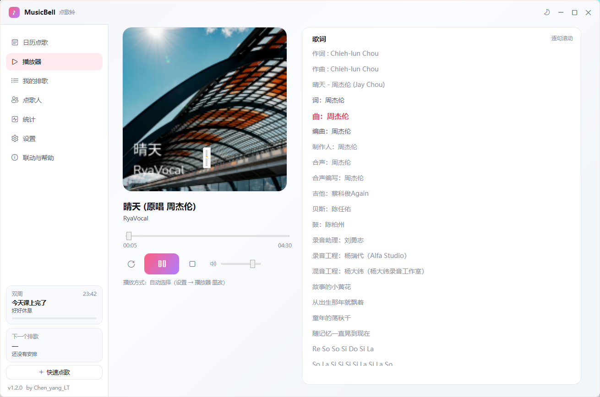

# MusicBell 点歌铃

给班级大屏用的**定时自动点歌**小工具：平时静默待在托盘，到点自己把网易云音乐叫到前台、搜索、播放，顺便告诉你「这一节放的是什么」。也能不打开网易云、用内置播放器直接放，带封面和滚动歌词。

## 它能做什么

- **日历式点歌**：点某一天 → 输入歌名（自动用网易云 API 联想，带封面）→ 选时间 → 存进当天日程。
- **到点自动放**：到时间点自动呼出网易云、键入搜索词、双击第一首播放，可选打开歌曲详情页。
- **排歌管理**：只放一次 / 每天 / 每周固定星期的重复规则，启用停用、一键试听、删除；同一分钟撞车会自动提示并可顺延。
- **点歌人统计**：每条排歌可填点歌人，支持导入 Excel/CSV 名单，按人统计点了多少首、点了什么、什么时候点的。
- **内置播放器**：设置里可以选「自动选择 / 内置播放器 / 网易云客户端」。内置播放器带封面、进度、音量与逐句滚动的歌词；会员曲拿不到直链时自动回落去开网易云客户端。
- **两个搜索源**：搜索框上方切「网易云 / B 站」，B 站结果到点用默认浏览器打开视频页；附带一个自动关掉 B 站登录弹窗的小浏览器扩展（设置里一键释放）。
- **点歌流程可编辑**：把「点搜索框 → 粘贴歌名 → 回车 → 双击第一首 → 开详情页」拆成步骤卡片，每一步的位置都能点「拾取」在屏幕上直接点一下录下来，存成相对窗口的比例，换分辨率、换 DPI 都不会偏。
- **课程感知**：读取 ClassIsland 的课程表（单双周、作息时间表），左下角显示当前/下节课、倒计时与进度。可设置「上课不点歌」，以及「上课前自动停掉正在放的东西」——内置播放器暂停、关掉网易云整个客户端、或者只关 B 站那一个标签页，提前量按秒填（0 = 正好打铃那一刻）。
- **统计页**：排歌总数、累计播放、点歌排行（前 8 名横条）、24 小时排歌时段分布、重复方式占比、最近 10 条播放记录。

- **ClassIsland 联动**：附带官方插件，六个行动 —— 放一首歌、放下一首排歌、播放/暂停、停止播放、打开网易云、关闭网易云。软件内的时间点和 ClassIsland 的行动两条路可以同时用。
- **深色/浅色主题**、窗口圆角、会跟着主题走的自绘界面。
- **开机自启**（写注册表 Run 项，被系统「启动应用」禁用、被安全软件拦住或 exe 换了位置时会自动改走启动文件夹快捷方式，并在设置页显示到底是哪种方式生效）、**关窗即隐到托盘**、**单实例**、**检测 GitHub 更新**（只提示，不自动装）。
- 配置与排歌全部是 JSON，**数据目录可以搬到任意位置**（U 盘也行）；提供 `protocol` 协议与命令行入口，方便别的程序调它。

## 下载与安装

到 [Releases](https://github.com/ChenyangLT/MusicBell/releases) 下载：

| 文件 | 说明 |
| --- | --- |
| `MusicBell-Setup-x.y.z.exe` | 安装包：开始菜单 + 可选桌面快捷方式 + 可选开机自启 |
| `MusicBell-x.y.z-win-x64.zip` | 便携版：解压即用，内置 .NET 运行时，不挑电脑 |
| `MusicBell.ClassIsland.cipx` | ClassIsland 插件包（也可以从软件「设置 → 联动」里一键释放） |

> 便携版解压后直接双击 `MusicBell.exe`。第一次运行会在 `%AppData%\MusicBell` 建配置，可在「设置 → 配置与数据」里搬走。

## 快速上手

1. 打开网易云音乐并登录一次（播放走的是你本机的客户端，会员曲、日推、歌单都不受影响）。
2. 打开 MusicBell → 「日历点歌」→ 选日期 → 在右下搜索框里打歌名 → 回车/点联想项。
3. 在弹窗里确认时间（可点时间胶囊）、写个「排歌名称」（比如「早读铃」）、要不要重复 → 「保存并排上」。
4. 到点前把网易云放着不管就行，剩下的它来做。

详细图文说明见 [docs/使用说明.md](docs/使用说明.md)。

## ClassIsland 联动

软件里集成了 ClassIsland 插件，两种用法可同时开：

- **软件自己排时间**：在 MusicBell 里排歌，软件负责到点播放（和 ClassIsland 是否运行无关）。
- **ClassIsland 触发**：「设置 → 联动」点「释放插件」→ 把 `.cipx` 装进 ClassIsland（或把文件夹丢进 `ClassIsland\data\Plugins\`）→ 在「自动化 → 行动」的「音乐铃」分组里挑：放一首歌 / 放下一首排歌 / 播放·暂停 / 停止播放 / 打开网易云 / 关闭网易云。插件源码在 [MusicBell.ClassIsland](https://github.com/ChenyangLT/MusicBell.ClassIsland)。

看到 ClassIsland 提示「该插件需要 2.1.x」是正常的：插件用的正是 2.1 的 API。

细节见 [docs/ClassIsland联动.md](docs/ClassIsland联动.md)。

## 数据与配置

默认目录 `%AppData%\MusicBell`：

| 文件 | 内容 |
| --- | --- |
| `config.json` | 所有设置（自启、静默、主题、网易云路径、点击位置、开关、数据目录指针等） |
| `songs.json` | 排歌列表 |
| `people.json` | 点歌人名单 |
| `playlog.json` | 播放记录（统计页与「最近播放」用） |
| `bili-tabs.json` | B 站标签页登记（上课前只关那一页靠它） |
| `author.json` / `author.jpg` | 关于页作者信息的缓存 |
| `covers\*.jpg` | 封面缓存 |
| `logs\app-*.log` | 运行日志 |

目录指针存在 `%AppData%\MusicBell\location.json`，所以搬到别处也不丢。

## 命令行与协议

~~~text
MusicBell.exe --silent                 # 静默启动（只驻留托盘）
MusicBell.exe --play "周杰伦 晴天"      # 立刻放一首
MusicBell.exe --play-next              # 放「下一个排歌」
MusicBell.exe --pause                  # 播放 / 暂停
MusicBell.exe --stop                   # 停止播放
MusicBell.exe --close                  # 关掉网易云
MusicBell.exe --open-native            # 打开网易云
~~~

对应的协议（ClassIsland 插件用的就是这些，别的程序也能调）：

| 协议 | 作用 |
| --- | --- |
| `musicbell://play?q=歌名&id=网易云ID&label=显示名&src=来源` | 放一首歌（带 `id` 时内置播放器可以直接放） |
| `musicbell://next?src=classisland` | 放「下一个排歌」 |
| `musicbell://pause` / `musicbell://stop` | 暂停 / 停止内置播放器 |
| `musicbell://close` | 关掉网易云客户端 |
| `musicbell://open` | 打开网易云客户端 |

## 从源码构建

需要 .NET 8 SDK、Windows。

~~~powershell
# 便携版 + 插件（输出到 dist\MusicBell，另出 zip）
powershell -ExecutionPolicy Bypass -File tools\build.ps1

# 只出目录、不打包 zip、不编安装包
powershell -ExecutionPolicy Bypass -File tools\build.ps1 -NoZip -NoInstaller

# 依赖系统 .NET 8 桌面运行时的瘦身版
powershell -ExecutionPolicy Bypass -File tools\build.ps1 -FrameworkDependent
~~~

安装包需要 [Inno Setup 6](https://jrsoftware.org/isdl.php)（脚本在 `tools\installer.iss`）。

工程结构：

~~~text
src/MusicBell.App           WPF 主程序（界面、托盘、调度）
src/MusicBell.Core          配置存储、网易云自动化、课表解析、更新检测等
src/MusicBell.ClassIsland   ClassIsland 插件（行动）
tools/                      打包脚本、图标生成、测试工具
docs/                       使用说明、联动文档、截图
~~~

## 已知限制

- 客户端自动化是按窗口比例「点搜索框 + 粘贴 + 双击第一首」实现的。默认流程够用；网易云大改版后可以在「设置 → 播放与点歌方式 → 编辑流程」里重新拾取每一步的位置。
- 内置播放器靠网易云的直链接口，会员专属曲、部分版权曲拿不到直链，这时会自动回落到打开网易云客户端。
- 歌词取自网易云（原文/翻译/逐字注解都能解析）；少数歌只有纯文本歌词，这时会整段铺开、不跟时间走；网易云上完全没有歌词的会直接提示。
- B 站只做到「用默认浏览器打开视频页」，不接管网页里的播放；上课前关标签页是按登记的标题找浏览器窗口再发 Ctrl+W，标题被手动改过就找不到了（会退回按「哔哩哔哩」关键词兜底）。
- 只做了 Windows x64。

## 关于

作者：**Chen_yang_LT** · [GitHub](https://github.com/ChenyangLT) · [B 站](https://space.bilibili.com/3461567773411503)

插件：[MusicBell.ClassIsland](https://github.com/ChenyangLT/MusicBell.ClassIsland)

## 许可

[MIT](LICENSE)
