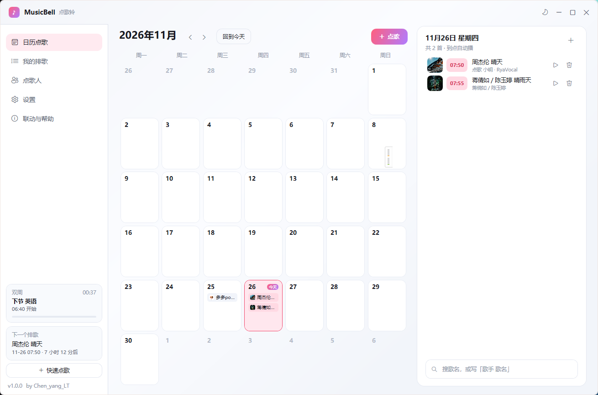
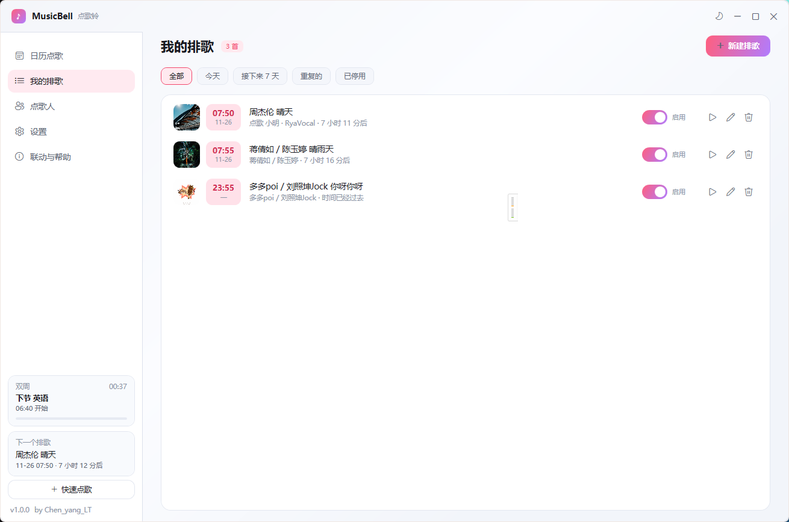
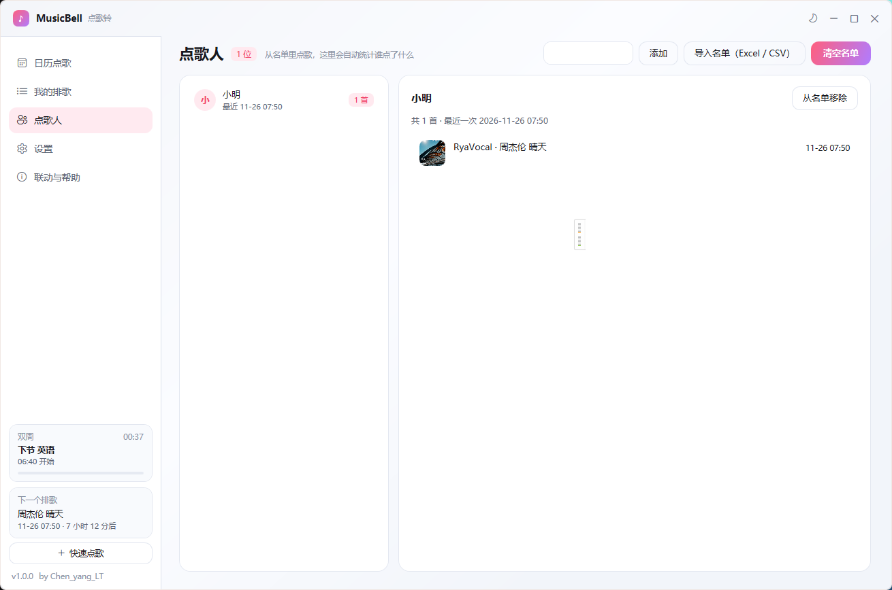

# MusicBell 点歌铃

给班级大屏用的**定时自动点歌**小工具：平时静默待在托盘，到点自己把网易云音乐叫到前台、搜索、播放，顺便告诉你「这一节放的是什么」。

## 它能做什么

- **日历式点歌**：点某一天 → 输入歌名（自动用网易云 API 联想，带封面）→ 选时间 → 存进当天日程。
- **到点自动放**：到时间点自动呼出网易云、键入搜索词、双击第一首播放，可选打开歌曲详情页。
- **排歌管理**：只放一次 / 每天 / 每周固定星期的重复规则，启用停用、一键试听、删除；同一分钟撞车会自动提示并可顺延。
- **点歌人统计**：每条排歌可填点歌人，支持导入 Excel/CSV 名单，按人统计点了多少首、点了什么、什么时候点的。
- **课程感知**：读取 ClassIsland 的课程表（单双周、作息时间表），左下角显示当前/下节课、倒计时与进度；可设置「上课不点歌」「上课自动关掉网易云」。
- **ClassIsland 联动**：附带官方插件（行动），在课表里用「行动」调起点歌；软件内的时间点和 ClassIsland 的行动两条路可以同时用。
- **深色/浅色主题**、窗口圆角、会跟着主题走的自绘界面。
- **开机自启**、**关窗即隐到托盘**、**单实例**、**检测 GitHub 更新**（只提示，不自动装）。
- 配置与排歌全部是 JSON，**数据目录可以搬到任意位置**（U 盘也行）；提供 `protocol` 协议与命令行入口，方便别的程序调它。

## 下载与安装

到 [Releases](https://github.com/ChenyangLT/MusicBell/releases) 下载：

| 文件 | 说明 |
| --- | --- |
| `MusicBell-Setup-x.y.z.exe` | 安装包：开始菜单 + 可选桌面快捷方式 + 可选开机自启 |
| `MusicBell-x.y.z-win-x64.zip` | 便携版：解压即用，内置 .NET 运行时，不挑电脑 |
| `MusicBell.ClassIsland.cipx` | ClassIsland 插件包（也可以从软件「设置 → 联动」里一键释放） |

> 便携版解压后直接双击 `MusicBell.exe`。第一次运行会在 `%AppData%\MusicBell` 建配置，可在「设置 → 配置与数据」里搬走。

## 快速上手

1. 打开网易云音乐并登录一次（播放走的是你本机的客户端，会员曲、日推、歌单都不受影响）。
2. 打开 MusicBell → 「日历点歌」→ 选日期 → 在右下搜索框里打歌名 → 回车/点联想项。
3. 在弹窗里确认时间（可点时间胶囊）、写个「排歌名称」（比如「早读铃」）、要不要重复 → 「保存并排上」。
4. 到点前把网易云放着不管就行，剩下的它来做。

详细图文说明见 [docs/使用说明.md](docs/使用说明.md)。

## ClassIsland 联动

软件里集成了 ClassIsland 插件，两种用法可同时开：

- **软件自己排时间**：在 MusicBell 里排歌，软件负责到点播放（和 ClassIsland 是否运行无关）。
- **ClassIsland 触发**：「设置 → 联动」点「释放插件」→ 把 `.cipx` 装进 ClassIsland（或把文件夹丢进 `ClassIsland\data\Plugins\`）→ 在「自动化 → 行动」里添加「MusicBell 放一首歌」。插件源码在 [MusicBell.ClassIsland](https://github.com/ChenyangLT/MusicBell.ClassIsland)。

看到 ClassIsland 提示「该插件需要 2.1.x」是正常的：插件用的正是 2.1 的 API。

细节见 [docs/ClassIsland联动.md](docs/ClassIsland联动.md)。

## 数据与配置

默认目录 `%AppData%\MusicBell`：

| 文件 | 内容 |
| --- | --- |
| `config.json` | 所有设置（自启、静默、主题、网易云路径、点击位置、开关、数据目录指针等） |
| `songs.json` | 排歌列表 |
| `people.json` | 点歌人名单 |
| `covers\*.jpg` | 封面缓存 |
| `logs\app-*.log` | 运行日志 |

目录指针存在 `%AppData%\MusicBell\location.json`，所以搬到别处也不丢。

## 命令行与协议

~~~text
MusicBell.exe --silent                 # 静默启动（只驻留托盘）
MusicBell.exe --play "周杰伦 晴天"      # 立刻放一首
MusicBell.exe --play-next              # 放「下一个排歌」
musicbell://play?q=%E5%91%A8%E6%9D%B0%E4%BC%A6%20%E6%99%B4%E5%A4%A9&label=%E6%97%A9%E8%AF%BB%E9%93%83&src=classisland
~~~

## 从源码构建

需要 .NET 8 SDK、Windows。

~~~powershell
# 便携版 + 插件（输出到 dist\MusicBell，另出 zip）
powershell -ExecutionPolicy Bypass -File tools\build.ps1

# 只出目录、不打包 zip、不编安装包
powershell -ExecutionPolicy Bypass -File tools\build.ps1 -NoZip -NoInstaller

# 依赖系统 .NET 8 桌面运行时的瘦身版
powershell -ExecutionPolicy Bypass -File tools\build.ps1 -FrameworkDependent
~~~

安装包需要 [Inno Setup 6](https://jrsoftware.org/isdl.php)（脚本在 `tools\installer.iss`）。

工程结构：

~~~text
src/MusicBell.App           WPF 主程序（界面、托盘、调度）
src/MusicBell.Core          配置存储、网易云自动化、课表解析、更新检测等
src/MusicBell.ClassIsland   ClassIsland 插件（行动）
tools/                      打包脚本、图标生成、测试工具
docs/                       使用说明、联动文档、截图
~~~

## 已知限制

- 网易云自动化是按窗口比例「点搜索框 + 粘贴 + 双击第一首」实现的，网易云大改版后可能要在设置里微调搜索框比例。
- 播放详情页、自动关闭网易云依赖客户端的固定布局，同理。
- 只做了 Windows x64。

## 关于

作者：**Chen_yang_LT** · [GitHub](https://github.com/ChenyangLT) · [B 站](https://space.bilibili.com/3461567773411503)

插件：[MusicBell.ClassIsland](https://github.com/ChenyangLT/MusicBell.ClassIsland)

## 许可

[MIT](LICENSE)
