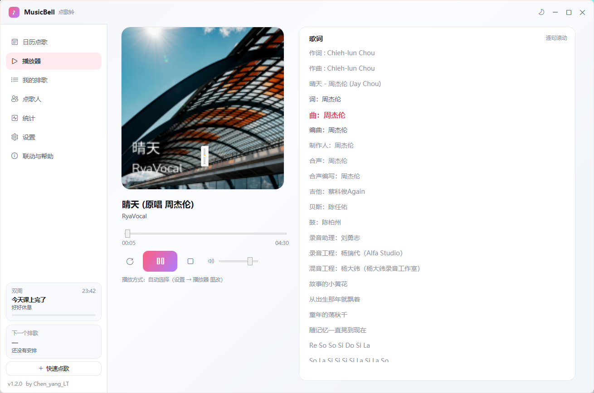
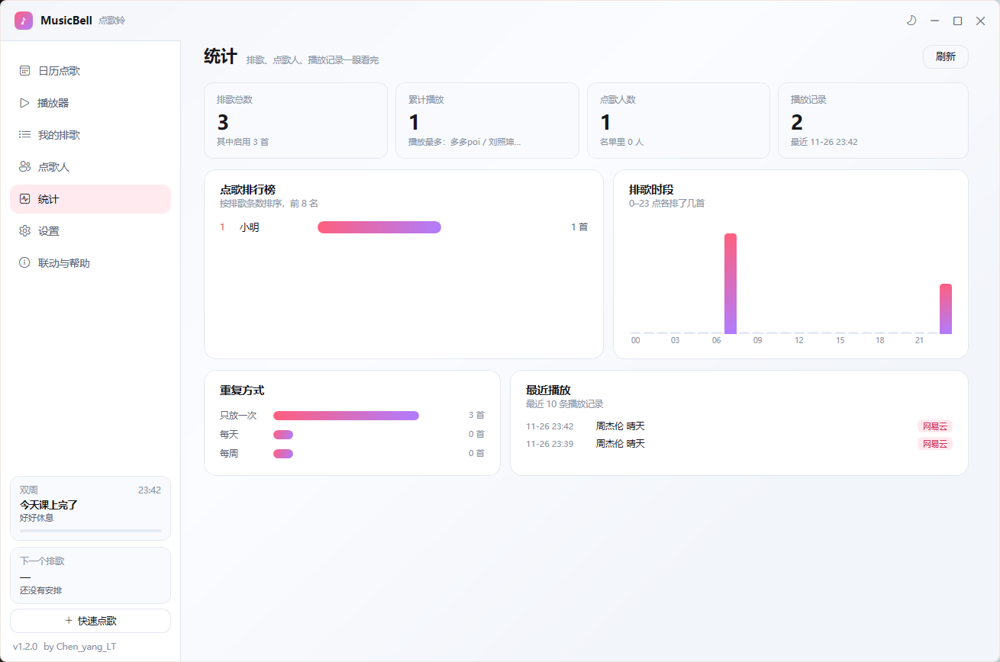

# 使用说明

## 一、界面总览

主窗口分三块：

- **左侧导航**：日历点歌 / 播放器 / 我的排歌 / 点歌人 / 统计 / 设置 / 联动与帮助。
- **左下角**：当前课程卡片（读 ClassIsland 课表，显示单双周、当前或下节课、倒计时和进度条）、「下一个排歌」、快速点歌按钮。
- **右侧内容**：当前页面的主体。

标题栏右上角的小太阳/月亮按钮用来切换**深色 / 浅色主题**（设置页里还能选「跟随系统」）。

## 二、日历点歌

1. 月历默认今天，用 `<` `>` 翻月或点「回到今天」。
2. 点某一天 → 右边会列出当天的排歌，并自动把光标放到搜索框。
3. 搜索框上方先选源：**网易云**（搜歌，回车/点联想项排进日程）或 **B 站**（搜视频，排进去的到点会用默认浏览器打开那一页）。
4. 在右下搜索框输入关键词 → 320 毫秒后自动联想，**带封面**，方向上键选中、回车确认。
5. 弹出的「排一首歌」窗口里可以改：
   - **歌名 / 搜索词**（会搜什么就填什么，左边是封面预览）
   - **日期 / 时间**（下面一排快捷时间是 07:00、07:50、09:40、12:10、17:30、21:00，也可以手打 `7:50`、`0750`、`7点半`）
   - **排歌名称**：到点弹出提醒时显示的名字，比如「早读铃」；留空就用歌名
   - **点歌人**：输入时自动从名单里联想，没在名单里会自动加进去
   - **重复**：只放一次 / 每天这个时间 / 每周这一天
   - **启用这一条**
6. 如果这个时间点已经有别的排歌，会提示「xx 已有……」并出现「顺延到 HH:mm」按钮，再点一次保存才是照排。
7. 右侧列表里：双击一行编辑，▶ 立刻试听，🗑 删除。

## 三、播放器

- 到点或用 ▶ 试听时，如果这首歌能拿到直链、并且放歌方式不是「网易云客户端」，就会在这里播：大封面、标题、进度条（可拖）、上一首/播放暂停/停止、音量。
- 右边是歌词，按时间逐句滚动，当前那句高亮；原文 + 翻译会成对显示，逐字注解（`(12,340,520)` 那种）会被去掉。
- 歌词取自网易云接口（`lv=-1&kv=-1&tv=-1&rv=-1`，lrc → yrc → klyric 依次兜底）。极少数歌只有纯文本歌词，这时整段铺开、不跟时间走，右上角会写「纯文本歌词 · 取自 …」；接口里完全没有歌词的会直接写「网易云上这首歌还没有歌词」。

- 会员曲拿不到直链会提示并自动回落去开网易云客户端，所以「自动选择」是默认值。
- B 站点歌走默认浏览器：可以在设置里选「B 站点歌时把窗口最大化」和「再按一下 F11 进网页全屏」。

## 四、统计

- 排歌总数（其中启用几条）、累计播放、点歌人数、播放记录条数。
- 点歌排行榜：按人统计点了多少首（前 8 名横条）。
- 排歌时段：0–23 点各排了几首的柱状图。
- 重复方式：只放一次 / 每天 / 每周各多少条。
- 最近播放：最近 10 条记录（时间、标题、来源、成功或失败）。

## 五、我的排歌

把全部排歌横向铺开，顶部可按 全部 / 今天 / 接下来 7 天 / 重复的 / 已停用 过滤。

- 右侧开关控制单条启用；
- ▶ 立刻播放、✎ 编辑、🗑 删除；
- 副标题会写「点歌 谁 · 每天 · 还有多久」。

## 六、点歌人

- 左边是名单，点一个人，右边就是**他/她点过的歌**（带封面、时间、排歌名）。
- 名额统计来自排歌记录里的「点歌人」，所以只要排歌时写了名字，这里就会自动出现。
- 「导入名单」支持 `.xlsx` / `.xls` / `.csv`：自动找「姓名 / 名字 / 学生 / 点歌人 / Name」表头，找不到就取第一列；表头右侧带「班 / 组 / 队」的列会作为分组。
- 「添加」手动加一个人，「从名单移除」只删名单、不删歌。

## 七、设置

### 常规
- 开机自启动（写 `HKCU\...\Run`，带 `--silent`；写不进去、被系统「启动应用」禁用或 exe 换了位置时，会自动改走启动文件夹快捷方式，下面的小字会说明当前是哪一种方式）
- 启动后静默在后台、关闭窗口时缩到托盘、到点弹小提示
- 新排歌的默认时间（`07:50` 就是默认值）
- **外观主题**：深色 / 浅色 / 跟随系统

### 网易云播放
- **网易云安装位置**：一般自动认出 `cloudmusic.exe`，认不出就手点。
- **试一次**：立刻用当前配置去搜一首《晴天》，用来校准点击位置。
- **搜索框位置**：相对网易云窗口的宽高比例，默认 `0.30 / 0.04`。点偏了就按比例微调。
- **键入等待**：每步之间等多少毫秒，老电脑可以调大。
- **提前量**：提前几秒开始操作，让音乐正好在整点响起。
- 三个开关：**用搜索框输入的方式播放**（关掉会改走 `orpheus://` 协议）、**播放前把网易云叫到最前**、**播放后还原剪贴板**。
- **自动播放第一首**：搜完双击第一条结果，直接开始放。
- **打开歌曲详情页**：播放后点开底部的播放详情（歌词页）。
- **播完自动关闭网易云**：按歌曲时长等到播完再关。

### 播放与点歌方式
- **放歌方式**：自动选择（能拿到直链就内置播放器，否则开客户端）/ 内置播放器 / 网易云客户端。
- **网易云 Cookie**：内置播放器想放会员曲时，把网页版 Cookie 粘进来（可选）。
- **点歌流程**：默认 7 步。点「编辑流程」会打开步骤卡片编辑器：
  - 每一步可以改名字、改文本（粘贴什么 / 按什么键 / 等多少毫秒）；
  - 点击类步骤点「拾取」→ 屏幕变暗 → 在网易云窗口里点一下要点的位置，自动记成相对窗口的比例（换分辨率、换 DPI 都不会偏）；
  - 可以加步骤（点击 / 双击 / 粘贴歌名 / 按键 / 等一会 / 打开链接）、上下移动、删除；
  - 「还原默认流程」一键回到内置的 7 步。
- **B 站防登录扩展**：「释放扩展」会在你选的位置生成一个浏览器扩展文件夹和同名 zip，Edge/Chrome 里「加载解压缩的扩展」即可，它会自动关掉 B 站的登录弹窗。

### 上课与课表
- **上课时不点歌**：撞上课程表的课时就跳过这次排歌。
- **上课前自动停掉正在放的东西**：总开关；提前量按秒填（0 = 正好打铃那一刻停）。
  - **停掉内置播放器**：软件自己放的直接暂停；
  - **关闭网易云客户端**：把 `cloudmusic.exe` 整个结束掉；
  - **只关 B 站那个标签页**：只对登记过的那一页发 Ctrl+W，不动整个浏览器。

### 配置与数据
- **数据目录**：默认 `%AppData%\MusicBell`，可「迁移到…」任意位置（U 盘也行），「恢复默认」搬回来。
- **运行日志**：出问题先看这里。

### ClassIsland 联动
- **注册协议** / **复制示例链接**：让别的程序用 `musicbell://play?...` 调它。
- **启用协议响应**：关掉之后 ClassIsland 就叫不动它（软件内排歌照常）。
- **释放插件**：导出 `MusicBell.ClassIsland.cipx` 和同名文件夹，拿去 ClassIsland 手动加载。

### 更新
- 启动时自动检查 GitHub 上的新版本（只提示，不自动下载），也可以点「立即检查」。

## 八、到点会发生什么

1. 托盘弹出小提示：「到点 · 早读铃」；
2. 网易云没开就先拉起来（等窗口加载）；
3. 窗口置前 → 点搜索框 → 全选 → 粘贴「歌手 歌名」→ 回车；
4. 若开了自动播放：双击第一条结果；若开了详情页：点开底部播放条（内置播放器这条路不需要这两步）；
5. 按设置决定要不要在播完后关掉网易云；快打铃时按「上课前自动停掉」的设置收尾；
6. `songs.json` 里记一次播放时间和次数。

## 九、出问题先看这里

| 现象 | 怎么办 |
| --- | --- |
| 到点没反应 | 看「设置 → 运行日志」；确认软件还在托盘；确认这条排歌是「启用」状态 |
| 打开了网易云但没搜到 | 用「试一次」校准搜索框比例；把「键入等待」调大 |
| 搜到了但没播放 | 打开「自动播放第一首」；网易云窗口要足够大，别最小化 |
| 卡在登录页 | 手动登录一次网易云，再试 |
| ClassIsland 里找不到行动 | 插件没加载成功：设置 → 插件里看是否「已启用」；也确认「自动化」总开关是开的 |
| 提示「需要 ClassIsland 2.1.x」 | 正常提示，插件用的就是 2.1 的 API |

更多：`docs/ClassIsland联动.md`。
